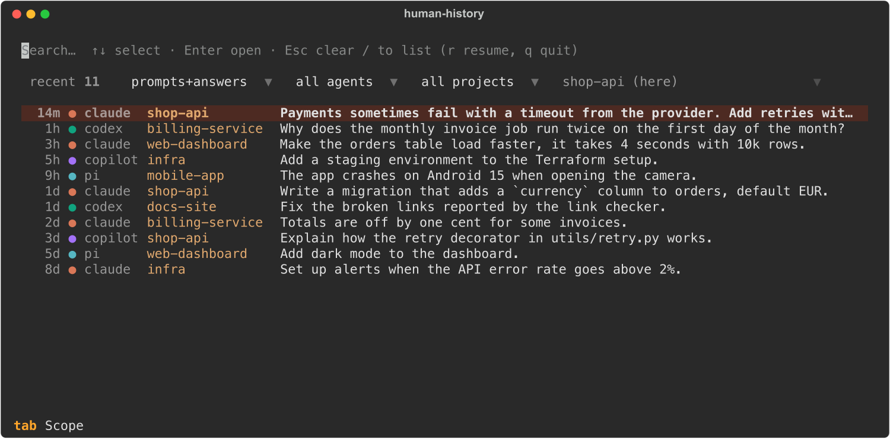

# human-history

Offline, keyboard-first history browser for **Claude Code**, **Codex CLI**, **OpenCode**,
**GitHub Copilot CLI** and **pi** sessions, built for
[Herdr](https://herdr.dev). It shows only the human conversation: your prompts and the agent's
visible answers. Tool calls, tool results, reasoning, system/hook events and raw JSON are never
displayed or indexed.

- Python 3.12, Textual/Rich TUI, Typer CLI, SQLite FTS5. No network, no telemetry, no AI calls.
- Separate search scopes: **my prompts**, **agent answers**, **both**, **titles** (fuzzy).
- Defaults to sessions from the **current git repository** (all its worktrees). `p` cycles
  worktree → repository → all projects.
- Resume in the session's original directory or in the current worktree, always explicitly.
- Herdr plugin `human-history`: overlay browser, resume into a new tab, and the overlay closes itself.



## Install

Install [uv](https://docs.astral.sh/uv/getting-started/installation/) first.

For Herdr:

```sh
herdr plugin install gandriyko/human-history/herdr-plugin
```

For the standalone CLI from a local checkout:

```sh
uv tool install /path/to/human-history
hh index
hh
```

See [Herdr plugin setup](docs/herdr.md) for actions, key bindings and local development.

## Use

Press `/` to search, `Enter` to read a conversation and `r` to resume a session. The `p` key
switches between the current worktree, its repository and all projects.

- [Usage and keyboard shortcuts](docs/usage.md)
- [Configuration and themes](docs/configuration.md)
- [Parsing, indexing and development](docs/internals.md)
