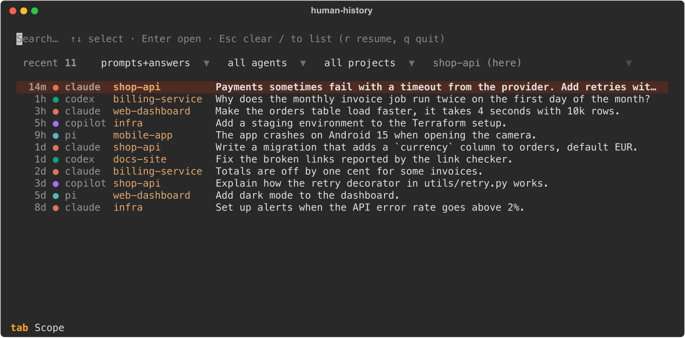

# human-history

Offline, keyboard-first history browser for **Claude Code**, **Codex CLI**, **OpenCode**,
**GitHub Copilot CLI**, **pi** and **Hermes Agent** sessions, built for
[Herdr](https://herdr.dev). It shows only the human conversation: your prompts and the agent's
visible answers. Tool calls, tool results, reasoning, system/hook events and raw JSON are never
displayed or indexed.

- A single Rust binary (ratatui TUI, SQLite FTS5). No network, no telemetry, no AI calls.
- Separate search scopes: **my prompts**, **agent answers**, **both**, **titles** (fuzzy).
- Defaults to sessions from the **current git repository** (all its worktrees). `p` cycles
  worktree → repository → all projects.
- Resume in the session's original directory or in the current worktree, always explicitly.
- Herdr plugin `human-history`: overlay browser, resume into a new tab, and the overlay closes itself.



## Install

Install a Rust toolchain ([rustup](https://rustup.rs)) first: the binary is built from source.

For Herdr:

```sh
herdr plugin install gandriyko/human-history/herdr-plugin
```

For the standalone CLI from a local checkout (installs `human-history` and its alias `hh` into
`~/.cargo/bin`):

```sh
cargo install --path /path/to/human-history
hh index
hh
```

The previous Python implementation lives on the `python` branch. Both use the same config and
index files.

See [Herdr plugin setup](docs/herdr.md) for actions, key bindings and local development.

## Use

Press `/` to search, `Enter` to read a conversation and `r` to resume a session. The `p` key
switches between the current worktree, its repository and all projects.

### For coding agents

[`skills/human-history/SKILL.md`](skills/human-history/SKILL.md) is an agent skill: it teaches an
agent to search your past sessions with `hh search --json` and read them with `hh show`. Link it
into the skills directory of an agent that supports `SKILL.md` skills, e.g. for Claude Code:

```sh
ln -s /path/to/human-history/skills/human-history ~/.claude/skills/human-history
```

- [Usage and keyboard shortcuts](docs/usage.md)
- [Configuration and themes](docs/configuration.md)
- [Parsing, indexing and development](docs/internals.md)
