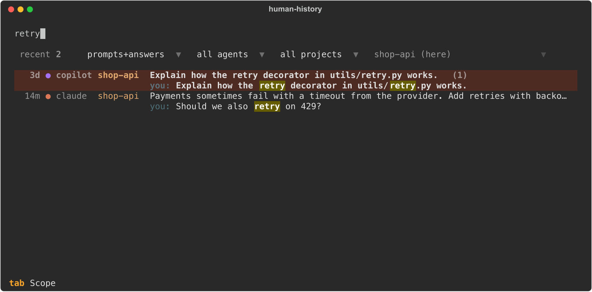
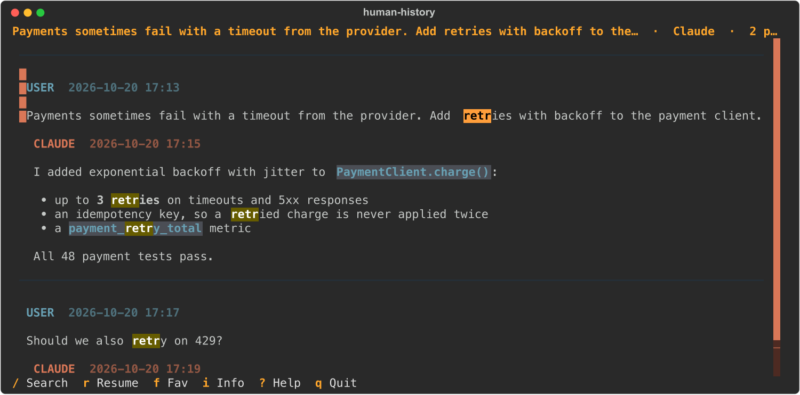

# human-history

Offline, keyboard-first history browser for **Claude Code**, **Codex CLI**, **OpenCode**,
**GitHub Copilot CLI** and **pi** sessions, built for
[Herdr](https://herdr.dev). It shows only the human conversation: your prompts and the agent's
visible answers. Tool calls, tool results, reasoning, system/hook events and raw JSON are never
displayed or indexed.

- Python 3.12, Textual/Rich TUI, Typer CLI, SQLite FTS5. No network, no telemetry, no AI calls.
- Separate search scopes: **my prompts**, **agent answers**, **both**, **titles** (fuzzy).
- Defaults to sessions from the **current git repository** (all its worktrees). `p` cycles
  worktree → repository → all projects.
- Resume in the session's original directory or in the current worktree, always explicitly.
- Herdr plugin `human-history`: overlay browser, resume into a new tab, and the overlay closes itself.


Typing searches prompts and answers; each hit shows the matching message:



Enter opens the conversation. `/` searches inside it vim-style, and `n` / `N` move between matches:



<sub>Screenshots use made-up demo sessions.</sub>

## Install

```sh
uv tool install /path/to/human-history          # puts `human-history` and `hh` on PATH
human-history index                            # first full index (later runs are incremental)
hh                                             # open the TUI
```

During development, `uv run human-history …` works from the checkout.

### Herdr plugin

Install [uv](https://docs.astral.sh/uv/getting-started/installation/) first. Herdr uses it to
prepare Python and the locked dependencies during plugin installation. Then install the plugin
directly from the public GitHub repository:

```sh
herdr plugin install gandriyko/human-history/herdr-plugin
herdr plugin action list --plugin human-history
```

The `/herdr-plugin` suffix selects the directory containing `herdr-plugin.toml`. The install
builds the CLI inside Herdr's managed checkout; a separate `uv tool install` is not required.
For local development, link this checkout instead:

```sh
herdr plugin link /path/to/human-history/herdr-plugin
```

`plugin link` skips the build, so run `uv sync --no-dev` in the checkout first.

Optionally bind a free key in `~/.config/herdr/config.toml` and run
`herdr server reload-config`:

```toml
[[keys.command]]
key = "f6"
type = "plugin_action"
command = "human-history.recent-here"
description = "Humanized AI Session History"
```

| Action | What it does |
|---|---|
| `human-history.open` | Browser using your default project filter |
| `human-history.recent-here` | Browser limited to the focused pane's repository, including its worktrees |
| `human-history.search` | Browser over all projects, for searching everything |
| `human-history.resume-last` | Resume the newest session of the focused worktree in its own directory, with no UI |
| `human-history.refresh-index` | Incremental re-index, with a Herdr notification |

The browser opens as an overlay by default. Set `[herdr] history_placement` to `popup`, `zoomed`,
`split` or `tab` to change that. When you resume, the session opens in a new tab or split
(`[resume] placement`) and the history pane exits, so no pane is left behind. If a pane is
already running that session, Herdr focuses it instead of starting a duplicate:
- Claude sessions are matched by Herdr's agent session id.
- Other agents' sessions are matched by process argv.

The plugin launcher (`herdr-plugin/hh.sh`) looks for the CLI in this order:
1. `$HUMAN_HISTORY_BIN`
2. The CLI built in the plugin checkout's `.venv`
3. `human-history` on PATH, including `~/.local/bin`
4. `uv run` in the checkout

To appear in the [Herdr plugin marketplace](https://herdr.dev/docs/marketplace/), make the
GitHub repository public and add the `herdr-plugin` repository topic. Herdr discovers a valid
manifest on the default branch automatically; no separate submission is needed.

## Keys

The screen shows one thing at a time. The home page is a centered list with one line per
session: age, agent, project (repository name) and title. While you search, a second line shows
the matching message.

Above the list are the session count and four dropdowns, which work with the mouse or the keys
below:
- search scope
- agent
- project filter: this worktree / whole repository / all projects
- the project those filters refer to: the current one, or any other project that has sessions

At start the cursor is in the session list; press `/` or click the search box to type a query.
`Enter` opens the selected conversation full-width, and `Esc` goes back.

**Search box** (`/` or click, fzf-style)

| Key | Action |
|---|---|
| typing | Filters the list as you type |
| `↑` `↓` (`Ctrl+P` `Ctrl+N`), `PgUp` `PgDn` | Move through sessions while you keep typing |
| `Enter` | Open the selected conversation for reading (this does not resume it) |
| `Tab` | Cycle scope: prompts → answers → both → titles |
| `Ctrl+U` / `Ctrl+A` / `Ctrl+Shift+A` | Prompts only / answers only / both |
| `Esc` | Clear the whole search at once. On an empty search, move to the list, where single-key actions such as `r`, `f`, `i`, `q` work |

**Session list**

| Key | Action |
|---|---|
| `j` `k` `↑` `↓` | Move through sessions |
| `Enter` | Open the conversation |
| `/` | Go to the search box |
| `Esc` | Clear the search; on an empty one, press twice to quit |
| `p` | Project filter: worktree → repository → all (remembered) |
| `o` | Choose a project (opens the dropdown) |
| `a` | Agent: all → Claude → Codex → OpenCode → Copilot → Pi |
| `s` | Sort: recent / created / title (remembered) |
| `t` | Theme picker with live preview (remembered) |

**Conversation**

`/` works like vim's `/`:
- Matches are found and highlighted while you type.
- `Enter` jumps to the first match.
- `n` / `N` go to the next / previous match and wrap around.
- `Esc` cancels.
- Smartcase: the search ignores case unless the text has a capital letter.

| Key | Action |
|---|---|
| `/` | Search inside this conversation |
| `n` / `N` | Next / previous occurrence, including several in one message. The current one is orange, and the title bar shows `[3/12]`. After opening a search result, these walk its matches |
| `j` `k` `↑` `↓` | Move between messages (`PgUp` / `PgDn` to scroll a long message) |
| `g` / `G` | First / last message |
| `Esc` | Back to the session list |

**Everywhere**

| Key | Action |
|---|---|
| `r` | Resume |
| `f` | Favorite (pinned to the top) |
| `i` | Session information (popup) |
| `y` | Copy the focused message, or all marked messages |
| `Space` | Mark a message, to copy a section |
| `Y` | Copy the whole conversation |
| `Ctrl+R` | Re-index now |
| `?` | Help |
| `q` | Quit |
| `Ctrl+C` twice | Quit from anywhere, including while typing. A single press copies the selected text |
| `Esc` twice | Quit from the home page when the search is empty. Elsewhere `Esc` steps back first: out of the find bar, then the conversation, then clears the search |

Shortcuts do not depend on the keyboard layout. On a Ukrainian or Russian ЙЦУКЕН layout:
- A key acts like the Latin key in the same position, so `й` = `q`, `к` = `r`, `т` = `n` and
  `ф` = `a`.
- The `/` key types `.`, but works as `/`.
- `Ctrl+Г` = `Ctrl+U`.
- In the search and find boxes, letters are still typed as Cyrillic text. Only `Ctrl` combinations
  are mapped there.

Copying uses OSC 52, so it works over SSH in Kitty, Ghostty and Herdr. You can also select text
with the mouse.

The search box accepts filters: `agent:codex`, `branch:main`, `since:2026-10-01`,
`until:2026-10-15`, `cwd:.` (sessions started in exactly this directory). Words are ANDed. The last
word matches as a prefix, and `"quoted phrases"` match exactly.

Some terminals cannot send `Ctrl+Shift+A`. Either use `Tab`, or rebind it under `[keys]`.

## CLI

```sh
hh                                    # TUI (same as `hh tui`)
hh tui --filter repository --scope user --query "SQLAlchemy"
hh search joinedload --scope assistant --filter all
hh search "approval workflow" --agent codex --since 2026-10-01
hh show 11111111                      # print a session as Markdown (id prefix)
hh resume-last                        # newest session of this worktree, in its own directory
hh index [--rebuild]
hh config                             # validate and print the effective configuration
hh config --init                      # create the config file from the documented example
```

## Configuration

The settings live in a TOML file: `~/.config/human-history/config.toml`, or the path in
`$HUMAN_HISTORY_CONFIG`.

```sh
hh config --init      # writes the fully documented example (refuses to overwrite; --force does)
$EDITOR ~/.config/human-history/config.toml
hh config             # validates it and prints the effective settings
```

- Every key is optional, so keep only what you change.
- Unknown keys and invalid values stop the app with the exact location, for example
  `colors.selection: not a colour: 'not-a-colour'`.
- Changes apply the next time the app starts.

The complete file, with every option set to its default, is
[`src/human_history/config.example.toml`](src/human_history/config.example.toml). Its sections:

| Section | What it controls |
|---|---|
| `[ui]` | Theme (see [Themes](#themes)) and date format |
| `[colors]` | Selection, scrollbar, project/agent and search-match colours |
| `[search]` | Default scope, project filter, sort order and list size |
| `[resume]` | Directory policy (`ask` / `current` / `original`), Herdr placement, auto-close |
| `[herdr]` | How the plugin opens the browser: overlay, popup, zoomed, split or tab |
| `[index]` | Auto-refresh interval and database location |
| `[paths]` | Where each agent's logs are read from |
| `[keys]` | Any shortcut (`action = "key,other-key"`, Textual key names) |

### Examples

Change only the colours. Values can be `#hex`, `rgb(…)` or colour names:

```toml
[colors]
selection = "#263a2f"          # sage-green selected row
selection_accent = "#7fb88f"   # matching scrollbar thumb and focused-message bar
project = "teal"
```

Search only your own prompts across all projects by default, newest sessions first:

```toml
[search]
default_scope = "user"
default_project_filter = "all"
sort = "created_desc"
```

Always resume in the session's own directory, in a split next to the current pane:

```toml
[resume]
directory = "original"
placement = "split-right"
```

Open the browser as a centered popup in Herdr instead of an overlay:

```toml
[herdr]
history_placement = "popup"
popup_size = "80%"
```

Read logs from extra locations, such as a second Claude config dir or a synced backup:

```toml
[paths]
claude = ["~/.claude/projects", "~/.claude-work/projects"]
codex = ["~/.codex/sessions", "/mnt/backup/codex/sessions"]
```

Rebind shortcuts. A key can have several names, separated by commas:

```toml
[keys]
scope_both = "ctrl+b"          # for terminals that cannot send Ctrl+Shift+A
resume = "r,ctrl+o"
quit = "q,ctrl+q"
```

Use a fixed theme and fewer background refreshes:

```toml
[ui]
theme = "gruvbox-light"

[index]
refresh_interval_seconds = 120
```

### Themes

The themes have the same names as Herdr's: `terminal`, `catppuccin`, `catppuccin-latte`,
`tokyo-night`, `tokyo-night-day`, `dracula`, `nord`, `gruvbox`, `gruvbox-light`, `one-dark`,
`one-light`, `solarized`, `solarized-light`.
- The default, `auto`, follows Herdr's `[theme] name` when running inside Herdr. Elsewhere it uses
  `terminal`.
- `terminal` keeps the terminal's own colours and background. Every other theme paints its own.
- `t` opens a picker that previews the highlighted theme. Enter keeps it, and the choice is
  remembered over `[ui] theme`. Esc restores the previous theme.
- Under a named theme, the selection and scrollbar colours come from the theme, unless `[colors]`
  sets `selection` or `selection_accent` to something other than the default.

`show_tool_calls`, `show_tool_results`, `show_reasoning` and `show_system_messages` are accepted
under `[ui]` only as `false`, because technical events are never displayed.

The choice of filter, sort and remembered resume policy is stored in the index database. The
"Remember this choice" box in the resume dialog saves the resume policy. To be asked again, delete
`resume_directory` from the `kv` table. `hh index --rebuild` also resets it, but it clears
favorites too.

## Resume rules

- `original`: resume in the directory recorded with the session.
- `current`: resume in the current worktree. If that differs from the original directory, you are
  asked to confirm first.
- `ask`: a dialog shows both paths and marks any that no longer exist.
- Before anything is launched, the target directory must exist, the agent CLI must be on PATH, and
  the session id must match `[A-Za-z0-9._-]`.
- Commands are argv lists. Inside Herdr the typed command line is built with `shlex.join`.
- The commands are `claude --resume <id>`, `codex resume <id>`, `opencode --session <id>`,
  `copilot --resume=<id>` and `pi --session <id>`.
- Claude Code, OpenCode and pi find sessions by project directory, so resuming one in another
  directory may fail (pi offers to fork it). The dialog says so.
- `hh resume-last` and `human-history.resume-last` always use the original directory.

## How the parsing works

**Claude Code** (`~/.claude/projects/<encoded-cwd>/<session>.jsonl`):
- Tool results arrive as `type=user` lines. A user line counts as a prompt only if it has none of:
  `tool_result` blocks, `isMeta`, `isCompactSummary`, `isSidechain`, or a non-human `origin`. It
  must also not be a wrapper: `<local-command-stdout>`, `<system-reminder>`,
  `<task-notification>`, interruptions, or compact summaries.
- Slash commands become `/name args`.
- Prompts typed while the agent is busy appear only as `attachment.queued_command`, so they are
  included. When one is also logged as a `user` line, the copy is dropped.
- Every assistant block has its own line. Only `text` blocks are kept, so text written next to a
  tool call survives. `thinking`, `tool_use` and `<synthetic>` messages are dropped.
- Titles come from `custom-title`, then `ai-title`, then the first prompt.
- Subagent transcripts (`<session>/subagents/`) are not indexed.

**Codex** (`~/.codex/sessions/YYYY/MM/DD/rollout-*.jsonl`):
- Prompts and answers are written twice, as `event_msg` and as `response_item`. Prompts come from
  the first copy and the immediate duplicate is skipped. Answers come from `response_item` only.
- Dropped: AGENTS.md / `<environment_context>` / `<user_instructions>` injections,
  developer/system messages, reasoning, `function_call(_output)`, `custom_tool_call` and token counts.
- The IDE wrapper (`## My request for Codex:`) is stripped.
- Older rollouts without the `{"type","payload"}` wrapper are supported.
- Titles come from `session_index.jsonl` (`thread_name`).

**OpenCode** 1.2+ (`~/.local/share/opencode/opencode.db`, SQLite, opened read-only):
- From the `session`, `message` and `part` tables only `text` parts are kept. User parts flagged
  `synthetic` or `ignored` (attached file contents, reminders, auto-continue) are dropped, and so
  are compaction summaries. `reasoning`, `tool`, `file`, `patch`, `step-*` and `subtask` parts are
  ignored.
- Child (subagent) sessions are skipped.
- There is no byte offset: each run re-reads the sessions changed since the last one. An answer
  still streaming is picked up once it completes.
- The older JSON-file storage (OpenCode 1.1 and earlier) is not read.

**GitHub Copilot CLI** (`~/.copilot/session-state/<id>/events.jsonl`):
- `user.message.content` is the prompt (`transformedContent` carries injected reminders).
  Instruction-discovery messages (`source` set) are dropped.
- Only the `content` of `assistant.message` is kept. `toolRequests`, `reasoningText`, tool, hook,
  skill and system events are ignored.
- Titles come from `workspace.yaml` (`name`, or `summary` in older versions).
- VS Code Copilot Chat is not indexed: it cannot be resumed from a terminal.

**pi** (`~/.pi/agent/sessions/--<cwd>--/<timestamp>_<id>.jsonl`):
- Only `user` text and the `text` blocks of `assistant` messages are kept. `thinking`,
  `toolCall`, `toolResult`, `bashExecution`, custom and summary entries are dropped.
- Expanded `/skill:` and `@file` blocks are stripped from the prompt.
- All branches are shown in file order. The title is the latest `session_info` name.

**Indexing**:
- Each file's size, mtime, inode, first bytes and the byte offset of its last complete line are
  stored.
- Unchanged files cost one `stat`. Appended files are read from the stored offset.
- A half-written last line waits for the next run.
- A truncated or rewritten file triggers a clean re-parse of its session.
- Malformed lines are counted and skipped.
- Sessions whose log files were deleted are removed from the index.
- The index uses WAL mode, batched commits, FTS5 (`unicode61`, diacritics folded) and
  `user_version` migrations.
- The original logs are only ever opened read-only.

**Safety**:
- C0/C1 control characters, including ESC, are stripped from all session text before it is stored
  or rendered.
- Markdown links are not turned into terminal hyperlinks.
- Nothing in conversation text is ever executed.

## Development

```sh
uv sync
uv run pytest
uv run ruff check src tests && uv run ruff format --check src tests
```

To add an agent, implement `parsers/base.Parser` (`discover`, `parse`, `titles`), register it in
`parsers/__init__.py`, and add a resume command in `integrations/resume.py`.
