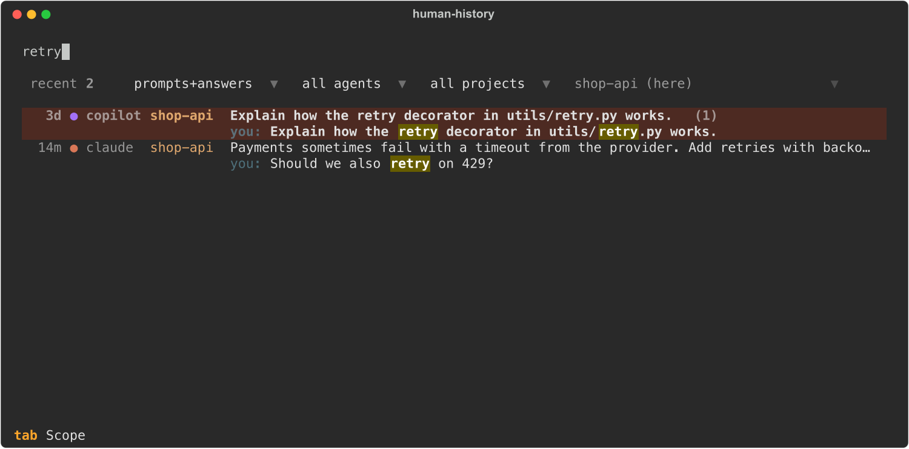
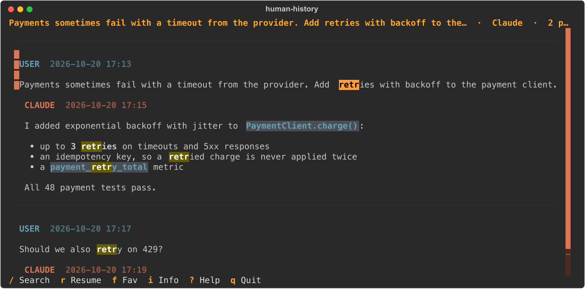

# Usage

[README](../README.md) · [Herdr plugin](herdr.md) · [Usage](usage.md) · [Configuration](configuration.md) · [Internals](internals.md)

Typing searches prompts and answers; each hit shows the matching message:



Enter opens the conversation. `/` searches inside it vim-style, and `n` / `N` move between matches:



<sub>Screenshots use made-up demo sessions.</sub>

## Keys

The screen shows one thing at a time. The home page is a centered list with one line per
session: age, agent, project (repository name) and title. While you search, a second line shows
the matching message.

Above the list are the session count and four dropdowns, which work with the mouse or the keys
below:
- search scope
- agent
- project filter: this worktree / whole repository / all projects
- the project those filters refer to: the current one, or any other project that has sessions

At start the cursor is in the session list; press `/` or click the search box to type a query.
`Enter` opens the selected conversation full-width, and `Esc` goes back.

**Search box** (`/` or click, fzf-style)

| Key | Action |
|---|---|
| typing | Filters the list as you type |
| `↑` `↓` (`Ctrl+P` `Ctrl+N`), `PgUp` `PgDn` | Move through sessions while you keep typing |
| `Enter` | Open the selected conversation for reading (this does not resume it) |
| `Tab` | Cycle scope: prompts → answers → both → titles (remembered) |
| `Ctrl+U` / `Ctrl+A` / `Ctrl+Shift+A` | Prompts only / answers only / both |
| `Esc` | Clear the whole search at once. On an empty search, move to the list, where single-key actions such as `r`, `f`, `i`, `q` work |

**Session list**

| Key | Action |
|---|---|
| `j` `k` `↑` `↓` | Move through sessions |
| `Enter` | Open the conversation |
| `/` | Go to the search box |
| `Esc` | Clear the search; on an empty one, press twice to quit |
| `p` | Project filter: worktree → repository → all (remembered) |
| `o` | Choose a project (opens the dropdown) |
| `a` | Agent: all → Claude → Codex → OpenCode → Copilot → Pi → Hermes (remembered) |
| `s` | Sort: recent / created / title (remembered) |
| `t` | Theme picker with live preview (remembered) |

**Conversation**

`/` works like vim's `/`:
- Matches are found and highlighted while you type.
- `Enter` jumps to the first match.
- `n` / `N` go to the next / previous match and wrap around.
- `Esc` cancels.
- Smartcase: the search ignores case unless the text has a capital letter.

| Key | Action |
|---|---|
| `/` | Search inside this conversation |
| `n` / `N` | Next / previous occurrence, including several in one message. The current one is orange, and the title bar shows `[3/12]`. After opening a search result, these walk its matches |
| `j` `k` `↑` `↓` | Move between messages (`PgUp` / `PgDn` to scroll a long message) |
| `g` / `G` | First / last message |
| `Esc` | Back to the session list |

**Everywhere**

| Key | Action |
|---|---|
| `r` | Resume |
| `f` | Favorite (pinned to the top) |
| `i` | Session information (popup) |
| `y` | Copy the focused message, or all marked messages |
| `Space` | Mark a message, to copy a section |
| `Y` | Copy the whole conversation |
| `Ctrl+R` | Re-index now |
| `?` | Help |
| `q` | Quit |
| `Ctrl+C` twice | Quit from anywhere, including while typing |
| `Esc` twice | Quit from the home page when the search is empty. Elsewhere `Esc` steps back first: out of the find bar, then the conversation, then clears the search |

Shortcuts do not depend on the keyboard layout. On a Ukrainian or Russian ЙЦУКЕН layout:
- A key acts like the Latin key in the same position, so `й` = `q`, `к` = `r`, `т` = `n` and
  `ф` = `a`.
- The `/` key types `.`, but works as `/`.
- `Ctrl+Г` = `Ctrl+U`.
- In the search and find boxes, letters are still typed as Cyrillic text. Only `Ctrl` combinations
  are mapped there.

Copying uses OSC 52, so it works over SSH in Kitty, Ghostty and Herdr. The app captures the mouse;
to select text with it, hold `Shift` (or `Option` in iTerm2 and Terminal.app) while dragging.

The search box accepts filters: `agent:codex`, `branch:main`, `since:2026-10-01`,
`until:2026-10-15`, `cwd:.` (sessions started in exactly this directory). Words are ANDed. The last
word matches as a prefix, and `"quoted phrases"` match exactly.

Some terminals cannot send `Ctrl+Shift+A`. Either use `Tab`, or rebind it under `[keys]`.

## CLI

```sh
human-history                                    # TUI (same as `human-history tui`)
human-history tui --filter repository --scope user --agent claude --query "SQLAlchemy"
human-history search joinedload --scope assistant --filter all
human-history search "approval workflow" --agent codex --since 2026-10-01
human-history search retry --json                # matching sessions as a JSON array (snippets without markup)
human-history show 11111111                      # print a session as Markdown (id prefix)
human-history show 11111111 --json               # session + messages (role, ts, raw text) as JSON
human-history favorite 11111111                  # star a session (human-history unfavorite removes the star)
human-history resume-last                        # newest session of this worktree, in its own directory
human-history index [--rebuild]
human-history config                             # validate and print the effective configuration
human-history config --init                      # create the config file from the documented example
```

## Resume rules

- `original`: resume in the directory recorded with the session.
- `current`: resume in the current worktree. If that differs from the original directory, you are
  asked to confirm first.
- `ask`: a dialog shows both paths and marks any that no longer exist.
- Before anything is launched, the target directory must exist, the agent CLI must be on PATH, and
  the session id must match `[A-Za-z0-9._-]`.
- Commands are argv lists. Inside Herdr the typed command line quotes every argument for a POSIX
  shell.
- The commands are `claude --resume <id>`, `codex resume <id>`, `opencode --session <id>`,
  `copilot --resume=<id>`, `pi --session <id>` and `hermes [-p <profile>] --resume <id>
  --no-restore-cwd` (Hermes would otherwise switch back to the recorded directory itself).
- Claude Code, OpenCode and pi find sessions by project directory, so resuming one in another
  directory may fail (pi offers to fork it). The dialog says so.
- `human-history resume-last` and `human-history.resume-last` always use the original directory.
